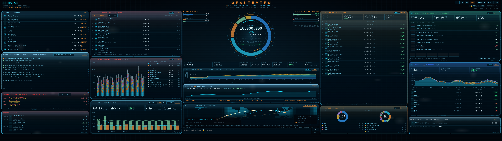
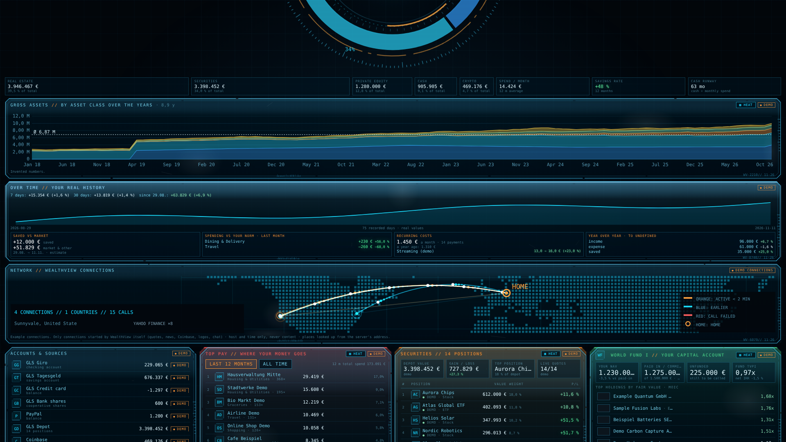
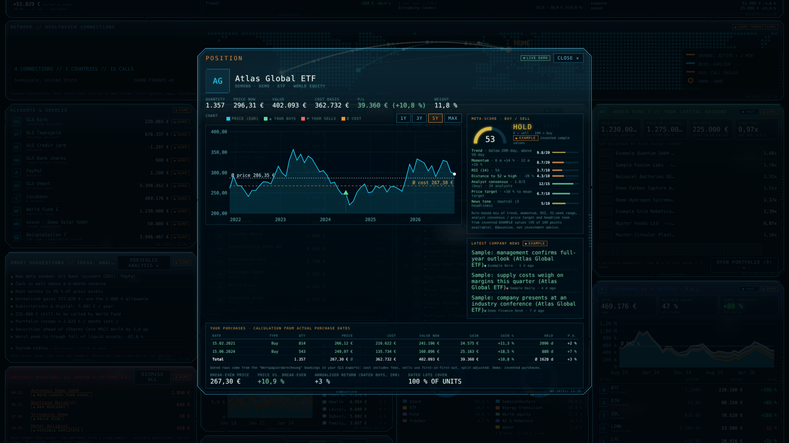
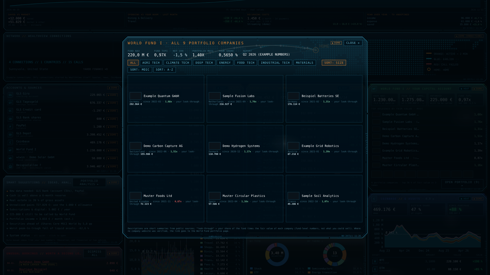
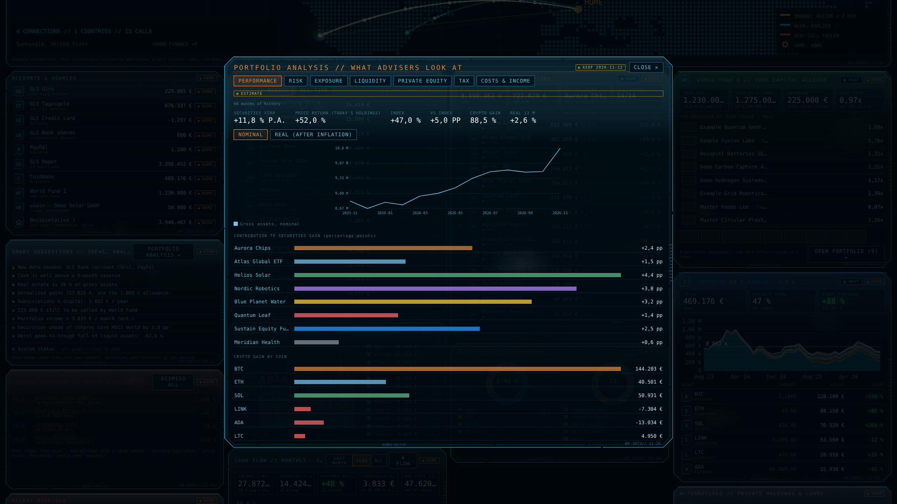
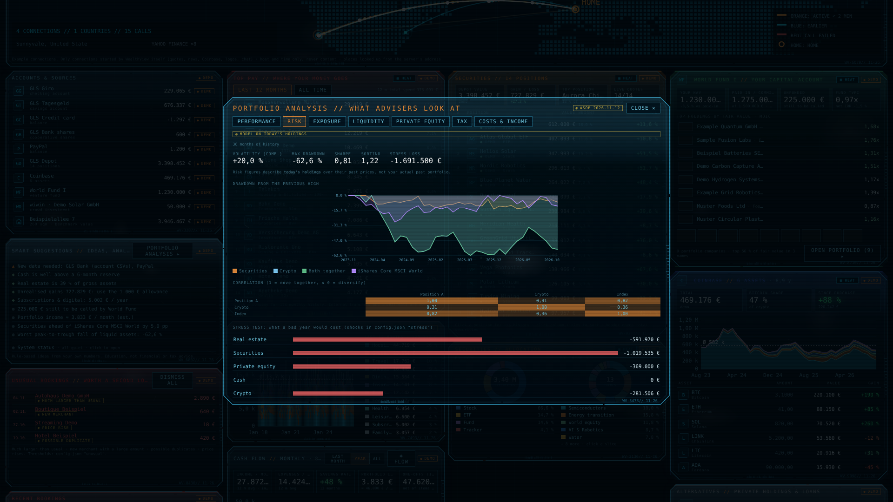

<h1 align="center">
  
</h1>

<p align="center"><em>Your whole portfolio in one Iron-Man-style dashboard. Local-first, read-only, no cloud.</em></p>

<p align="center">
  
  
  
  
  
  
  
  
  
</p>

<p align="center">
  <a href="https://github.com/ChrisMan4000/WealthView/releases/latest/download/WealthView-Setup-public.exe">
    
  </a>
  <br>
  <sub><a href="https://github.com/ChrisMan4000/WealthView/releases/latest/download/WealthView-Setup-public.exe">WealthView-Setup-public.exe</a> &middot; about 3.4 MB &middot; <a href="https://github.com/ChrisMan4000/WealthView/releases">all releases</a></sub>
</p>

<p align="center">
  
</p>

> All screenshots in this repository show **demo mode** with invented numbers and invented companies.

---

## 🧭 What is WealthView?

WealthView aggregates bank accounts, securities, crypto, private-equity holdings and real estate into one live dashboard that runs **on your own PC**. It is a small Python program (standard library only) that serves a single HTML page on `127.0.0.1`; your files are read, never changed, and your balances never leave the machine.

It is the sibling of [IronMan-JARVIS](https://github.com/ChrisMan4000/IronMan-JARVIS): same HUD look, same local-first spirit.

## ⬇️ Download

| | |
|---|---|
| **[WealthView-Setup-public.exe](https://github.com/ChrisMan4000/WealthView/releases/latest/download/WealthView-Setup-public.exe)** | Windows setup wizard (Inno Setup), v1.17, about 3.4 MB |
| SHA-256 | `c4b8f5fe34d7f8a9700de476d4e0e47a82428553490bb29838d11fbce5be83b4` |

The wizard checks your PC (Python 3.10+, optional LM Studio for the Ask box), asks which folders hold your bank exports, your residence (for the tax estimate) and a password (4 to 1024 characters), and adds a desktop shortcut. It appears in *Windows Settings > Apps*; uninstall can keep or delete your data. The public edition contains **no personal data**.

> 🇩🇪 **Tested only in Germany.** WealthView has been used and tested only with German bank exports (GLS Bank CSVs), German locale and number formats, EUR and German tax rules. Other countries, banks and currencies may need adjustments.

## ✨ Features

- 💰 **Gross and net assets** in a live ring, with change since first investment per asset class
- 📈 **Over time:** daily recorded history, saved-vs-market split, spending against your own norm, recurring costs
- 📊 **Securities:** positions, buys/sells on the price chart, rule-based meta-score, news; allocation by type, theme, country, sector, currency
- 🚀 **Private equity:** venture-fund capital account and company pop-ups, crowd investments valued at cost
- 🪙 **Crypto:** Coinbase balances with FIFO cost basis (view-only API key)
- 💸 **Cash flow:** categories you can fix with editable rules, Sankey pop-up, unusual-booking alerts
- 🧮 **Portfolio analysis:** performance, risk, exposure, liquidity, tax (Germany), costs and income
- 💬 **Ask your data:** questions answered by a local model (LM Studio) that writes read-only queries
- 🌐 **Network map:** every outbound connection WealthView itself makes, host and time only
- 🔔 **Update reminder** chip when new bank exports are due, automatic import of new files
- 🙈 **Privacy blur**, demo mode, keyboard shortcuts (P blur, R refresh, F fullscreen, Esc close)

## 🖼️ Screenshots

<table>
  <tr>
    <td><a href="docs/screenshots/02-over-time.png"></a><br><sub>Over time, network map, accounts</sub></td>
    <td><a href="docs/screenshots/03-security.png"></a><br><sub>Position pop-up with buys, meta-score and news</sub></td>
  </tr>
  <tr>
    <td><a href="docs/screenshots/04-world-fund.png"></a><br><sub>Venture-fund portfolio overview</sub></td>
    <td><a href="docs/screenshots/05-analysis.png"></a><br><sub>Portfolio analysis: performance</sub></td>
  </tr>
  <tr>
    <td colspan="2"><a href="docs/screenshots/06-risk.png"></a><br><sub>Portfolio analysis: risk, correlation, stress test</sub></td>
  </tr>
</table>

## 🔒 Privacy

- Runs on `127.0.0.1:8780` only and checks the `Host` header; nothing is reachable from other computers.
- Your source folders (bank exports, PayPal, reports) are **only read, never changed**.
- WealthView does make outbound calls (full list in [`docs/ARCHITECTURE.md`](docs/ARCHITECTURE.md#10-outbound-connections-and-network-log)): market data (Yahoo Finance), headlines (Google News), company facts (Wikidata and company websites), inflation data (Eurostat), a server-location lookup (ip-api.com), web searches only when the Ask box asks for one, Coinbase if you add a view-only key, and **logo lookups that send merchant domains and coin symbols to icon services**. Set `"logo_lookup": false` in `config.json` to switch the logo lookups off. Only hosts and times are logged, never content.
- Access is protected by a password stored as a salted PBKDF2 hash. The installer asks for 4 to 1024 characters; `python server.py --set-pin` accepts any non-empty password, so choose a strong one. It is a convenience lock: the local database `wealthview.db` is **not encrypted**.
- No transactions are possible; WealthView cannot move money.
- Tax estimates cover Germany only. Rule-based hints are not financial or tax advice.

## 🛠️ Run from source

Python 3.10+ and nothing else (Node.js 18+ only for the optional Coinbase balances):

```powershell
copy config.default.json config.json
python server.py --set-pin      # sets your password (asked twice, hidden)
python server.py                # then open http://127.0.0.1:8780/
```

Demo mode (invented numbers) works without a password; click **Real numbers** to unlock your data. Settings live in `config.json`; defaults are documented in [`docs/ARCHITECTURE.md`](docs/ARCHITECTURE.md).

## 📚 Documentation

- [`docs/ARCHITECTURE.md`](docs/ARCHITECTURE.md): technical architecture (layers, data flow, security model)
- [`CHANGELOG.md`](CHANGELOG.md): what changed per version

## 🤝 Contributing

Issues and pull requests are welcome. Please never attach real bank exports, balances or screenshots of real data; use demo mode for screenshots.

## 📄 License

[MIT](LICENSE) © ChrisMan4000
